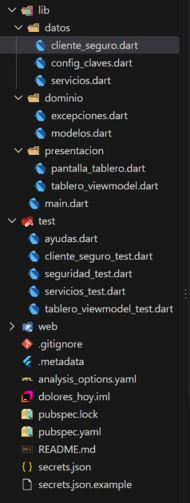
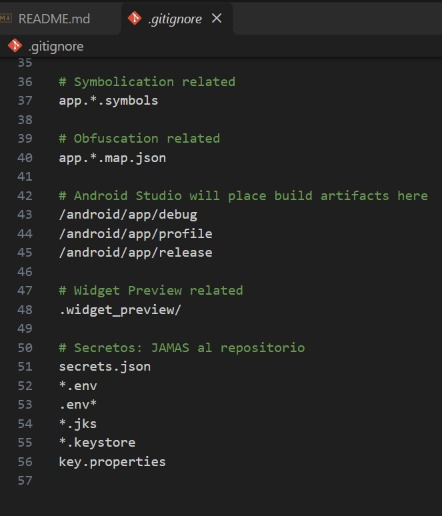
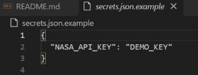
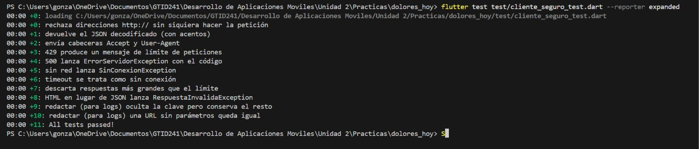
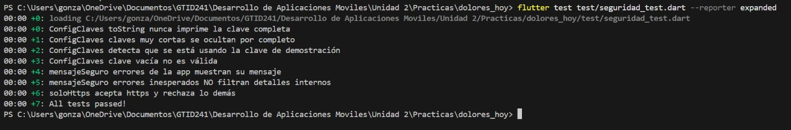
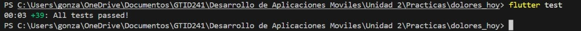
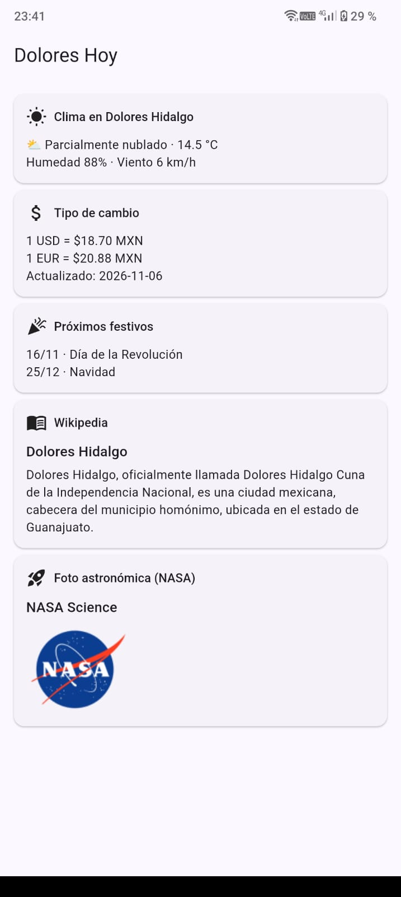
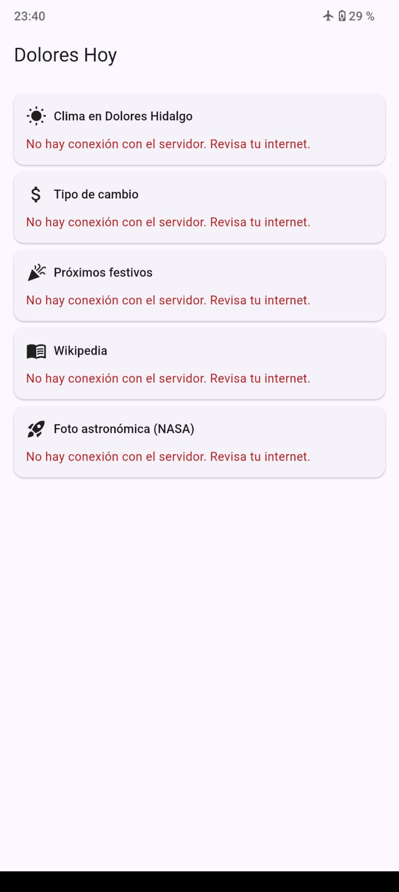
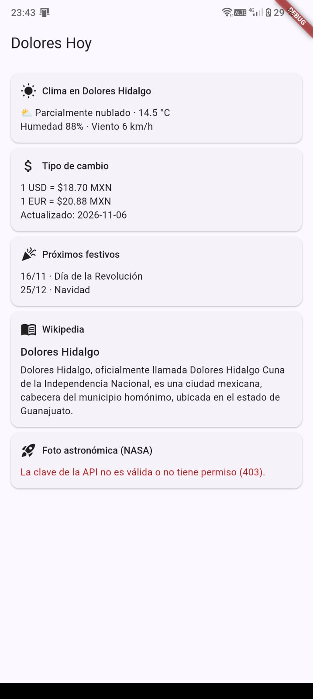

# Dolores Hoy · Flutter + 5 APIs con buenas prácticas de seguridad (TDD)

**Materia:** Desarrollo Móvil Integral
**Universidad:** UTNG, Dolores Hidalgo
**Alumno:** González López Yael Isaac
**Fecha:** 6 de Noviembre de 2026

## Descripción

Tablero de información de Dolores Hidalgo que consume 5 APIs gratuitas con un mismo cliente HTTP seguro: clima (Open-Meteo), tipo de cambio (Frankfurter), días festivos (Nager.Date), resumen de Wikipedia y foto astronómica de la NASA (con clave). Todo se desarrolló con TDD y se probó con `MockClient`, sin internet. Si una API falla, las otras cuatro siguen funcionando.

## Estructura del proyecto

## Evidencia de seguridad de secretos

### `.gitignore` con secretos y `git status` sin `secrets.json`

### Plantilla `secrets.json.example`

### Pruebas del cliente seguro

### Pruebas de seguridad

### Todas las pruebas en verde

## Evidencia de la aplicación

### Las 5 tarjetas cargadas

### Sin conexión: las 5 tarjetas muestran un mensaje amable y la app no se cierra

### Clave falsa de la NASA: solo esa tarjeta falla (403) y las otras 4 siguen bien

## Ciclo TDD y reto (opcional)

Reto: cambiar temporalmente Open-Meteo a `http://` y ver qué prueba falla.

